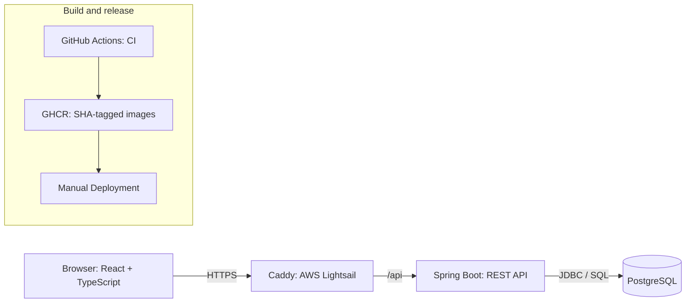

<div align="center">

<h1>Industrial Trend Explorer</h1>

<p>A sensor analytics dashboard for trends, anomalies, and clear explanations.</p>


[](https://industrial-trend-explorer.duckdns.org/)

[GitHub](https://github.com/mrrrxiii/industrial-trend-explorer) · [LinkedIn](https://www.linkedin.com/in/leikong-ottawa/)

</div>


## Key Features

- **Sensor Analytics** — explore Pump Pressure and Reactor Temperature.
- **Time-Window Analysis** — select 1H, 6H, or 24H ranges.
- **Anomaly Detection** — compare readings with configured normal ranges.
- **Trend visualization** — Recharts with normal-range and anomaly indicators.
- **REST API** — Spring Boot serves summaries and trends queried from PostgreSQL with JDBC and SQL.

## Architecture



## Build and release

- **CI:** GitHub Actions runs backend tests with Java 25 and frontend lint, tests, and production build with Node 24 on pushes and pull requests.
- **Container images:** After both CI jobs succeed on a push to `master`, GitHub Actions publishes `linux/amd64` images to **GHCR**, tagged with the full commit SHA.
- **Hosting:** **Docker Compose** runs Caddy, the Spring Boot API, and PostgreSQL on **AWS Lightsail**. Caddy provides **HTTPS** and routes `/api` to the API.
- **Release:** **Manual Deployment** uses the verified SHA-tagged images; GitHub Actions does not deploy the application.

## Run locally

Requires Docker Compose, Java 25, and Node.js 24.

1. Start PostgreSQL:

   ```bash
   docker compose up -d db
   ```

2. **First-time setup only:** initialize the schema and sample data for a new database volume. You do not need to rerun these commands each time you start the project.

   ```bash
   docker compose exec -T db psql -U app -d industrial_trends < db/schema.sql
   docker compose exec -T db psql -U app -d industrial_trends < db/seed.sql
   ```

3. In a terminal, start the API:

   ```bash
   cd backend
   ./mvnw spring-boot:run
   ```

4. In another terminal, install frontend dependencies and start the UI:

   ```bash
   npm --prefix frontend ci
   npm --prefix frontend run dev
   ```

   Open the local URL printed by Vite. The development server proxies `/api` to the backend on port 8080.

## Scope

Sensor readings are **synthetic**, and explanations use **mock AI output** by default (`MOCK — NOT AI`). This is a portfolio demo, not a live industrial monitoring or operational system.
