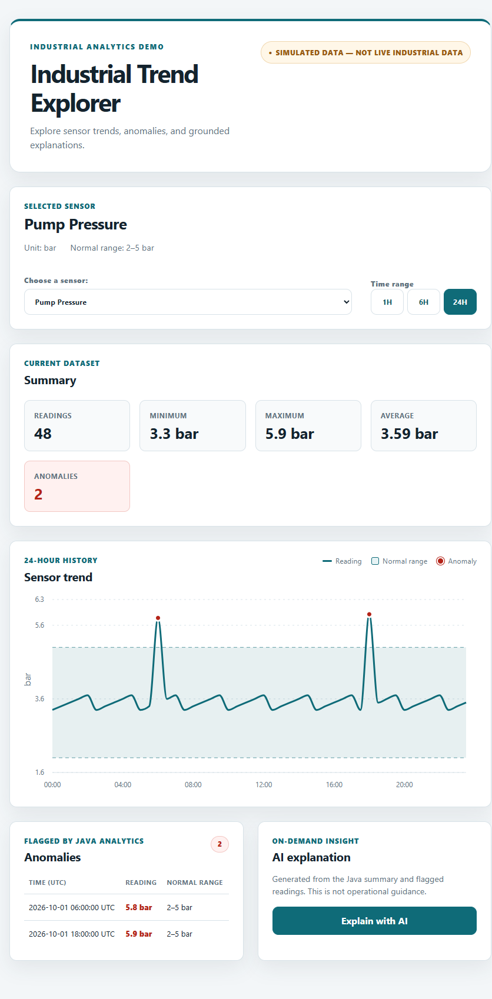

# Industrial Trend Explorer

**A full-stack sensor dashboard for exploring trends, anomaly readings, and on-demand explanations.**

**Keywords:** Java · Spring Boot · REST API · PostgreSQL · React · TypeScript · Recharts · Gemini API · LLM integration · data visualization

## Project author

[GitHub: @mrrrxiii](https://github.com/mrrrxiii) · [LinkedIn](https://www.linkedin.com/in/leikong-ottawa/)



*The dashboard uses synthetic sample data; it is not connected to live industrial equipment.*

## Overview

Choose a sensor and time range to see its trend, normal operating range, summary statistics, and readings flagged as anomalies. Request an explanation only when needed.

- **Two sensors:** Reactor Temperature and Pump Pressure
- **Analytics:** Java calculates summary statistics and flags anomalies
- **Visualization:** React, TypeScript, and Recharts
- **Storage and API:** PostgreSQL and Spring Boot REST endpoints
- **Explanations:** Deterministic mock by default; optional Gemini integration

## How it works

**Dashboard → Spring Boot API → PostgreSQL**

Java returns sensor readings and calculated summaries to the dashboard. The optional explanation request is sent only when a user clicks the button. The API key, when Gemini is enabled, stays on the backend.

## Time-range analytics

Choose **1H**, **6H**, or **24H**. The selected sensor's latest stored reading anchors the time window; its start and end are both included. Spring Boot accepts only those three values, PostgreSQL returns readings in the selected window, and Java recalculates the summary and anomalies before React updates the chart and table. The same range is used if the user requests an explanation.

```text
React selection → REST request (`hours`) → Spring Boot validation
→ PostgreSQL time window → Java analytics → updated dashboard
```

The explanation service builds a prompt from the filtered Java results. The Gemini provider sends that prompt to the model; it does not calculate the range or analytics. Trend and explanation requests accept `hours=1`, `hours=6`, or `hours=24` (default `24`); unsupported ranges return HTTP 400.

## Run locally

Start PostgreSQL and load the sample data from the project root:

```bash
docker compose up -d db
docker compose exec -T db psql -U app -d industrial_trends < db/schema.sql
docker compose exec -T db psql -U app -d industrial_trends < db/seed.sql
```

Start the backend in a separate terminal:

```bash
cd backend
./mvnw spring-boot:run
```

Start the frontend in another terminal at the project root:

```bash
npm --prefix frontend install
npm --prefix frontend run dev
```

Open the Vite URL shown in the terminal, usually `http://localhost:5173`.

## Optional Gemini mode

Mock mode is the default. For live explanations, configure `LLM_MODE=live`, `GOOGLE_API_KEY`, and `GEMINI_MODEL` in the **backend process environment only**. Never put the key in frontend code or commit it. The interface labels responses `MOCK — NOT AI` or `LIVE AI`.

A real Gemini request was verified with HTTP `200` and a non-empty response. Model access and quotas can change; explanations are informational and are not operational guidance.

## Verification

| Check | Result |
| --- | --- |
| Backend tests | 13 passed |
| Frontend tests | 14 passed |
| Frontend lint and production build | Passed |
| Seeded API data | 2 sensors, 48 readings and 2 anomalies per sensor |
| Time-range browser check | 1H, 6H, and 24H selection and updates checked with mocked API responses |
| Time-range API smoke check | Updated backend returned 3, 13, and 48 readings for 1H, 6H, and 24H; `hours=2` returned HTTP 400 |
| Responsive page | Checked at 375, 768, and 1280 pixels with no horizontal overflow |

Run the checks with:

```bash
cd backend && ./mvnw test
cd ..
npm --prefix frontend run lint
npm --prefix frontend test
npm --prefix frontend run build
```

## Scope

This is a portfolio and learning demo built with synthetic data. It is not a production monitoring system, a safety system, or a connection to real sensors.
