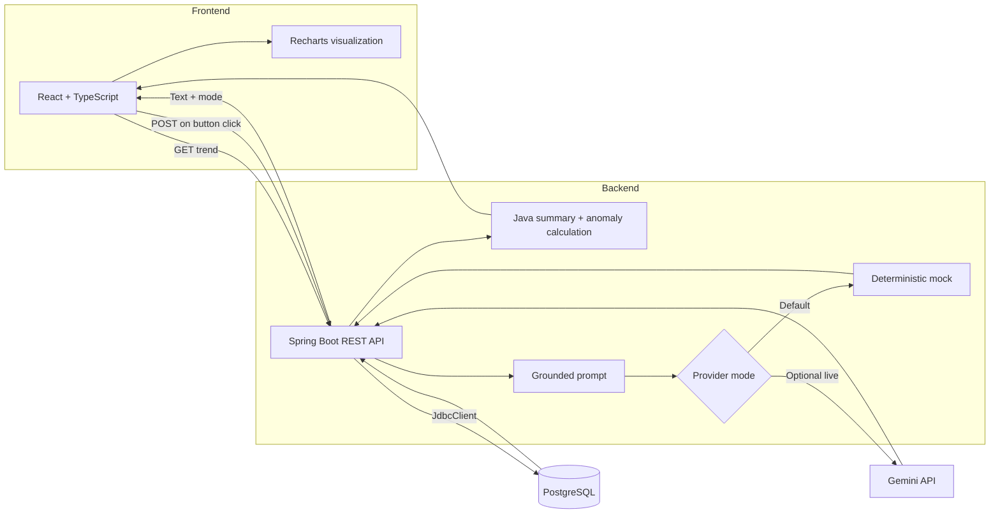

<div align="center">

# Industrial Trend Explorer

### Explore sensor data. Understand trends. Explain anomalies.

**A full-stack analytics demo with deterministic Java calculations and on-demand Gemini explanations.**

<p>
  
  
  
  
  
  
</p>

</div>

---

## Overview

Select a sensor to explore its readings, chart, summary, and anomalies. Request a grounded natural-language explanation with Gemini when needed.

| Sensors | Data points | Anomalies per sensor | AI provider |
|:---:|:---:|:---:|:---:|
| 2 | 48 each | 2 | Gemini 3.8 Flash |

> **Data notice:** All readings are synthetic. This demo is for learning and portfolio demonstration—not operational industrial monitoring or safety guidance.

## Architecture



## Features

| Area | Implementation |
| --- | --- |
| **Visualization** | Responsive Recharts trends with normal-range bands, anomaly markers, and five summary cards |
| **Analytics** | Java-calculated count, minimum, maximum, average, and anomaly count; accessible UTC anomaly table |
| **REST API** | Sensor and trend endpoints; unknown sensor IDs return HTTP `404` |
| **React data flow** | Typed UI, runtime JSON validation, loading/error/empty states |
| **Request handling** | `AbortController` prevents stale results after changing sensors |
| **Accessibility** | Keyboard-operable controls, visible focus, labeled chart and table, responsive layouts |
| **LLM integration** | Click-triggered Gemini request with a prompt grounded in calculated facts |
| **Credential safety** | Gemini API key remains on the backend; no browser-side secret |
| **Provider clarity** | Default mock is labeled `MOCK — NOT AI`; successful Gemini output is labeled `LIVE AI` |

## Gemini integration status

**Live request verified.** A real explanation request using `gemini-3.8-flash` returned HTTP `200`, non-empty generated text, the selected sensor ID, and `mode: "LIVE"`. The frontend displayed **LIVE AI**.

The backend uses Google's Java GenAI SDK. It extracts text from typed model-output steps when the SDK's convenience `outputText()` field is absent. This response handling is covered by unit tests.

Mock mode is the default. To use Gemini locally, configure `LLM_MODE=live`, `GOOGLE_API_KEY`, and `GEMINI_MODEL` **in the backend process only**. Never commit or expose the key. Model access, quotas, and terms may change; use synthetic data only.

## Technology keywords

<p>
  <kbd>Java</kbd> <kbd>Spring Boot</kbd> <kbd>REST API</kbd> <kbd>JDBC</kbd> <kbd>PostgreSQL</kbd>
  <br>
  <kbd>React</kbd> <kbd>TypeScript</kbd> <kbd>Recharts</kbd> <kbd>Data Visualization</kbd>
  <br>
  <kbd>Gemini API</kbd> <kbd>Google GenAI SDK</kbd> <kbd>LLM Integration</kbd> <kbd>Prompt Grounding</kbd>
  <br>
  <kbd>Runtime Validation</kbd> <kbd>AbortController</kbd> <kbd>JUnit</kbd> <kbd>Vitest</kbd> <kbd>Docker Compose</kbd>
</p>

## Run locally

**Versions used for the verified local build:**

| Tool | Version |
| --- | --- |
| Node.js | 24.22.0 |
| npm | 11.19.1 |
| Eclipse Temurin OpenJDK | 25.0.4.1 LTS |
| Docker Engine | 29.4.0 |
| Docker Compose | 5.1.2 |
| Git | 2.43.0 |

### 1. Start PostgreSQL and load the sample data

Run from the repository root:

```bash
docker compose up -d db
docker compose exec -T db psql -U app -d industrial_trends < db/schema.sql
docker compose exec -T db psql -U app -d industrial_trends < db/seed.sql
```

### 2. Start the backend

In a separate terminal:

```bash
cd backend
./mvnw spring-boot:run
```

### 3. Start the frontend

In another terminal at the repository root:

```bash
npm --prefix frontend install
npm --prefix frontend run dev
```

Open the Vite URL shown in the terminal (usually `http://localhost:5173`). Vite proxies API requests to Spring Boot on port `8080`; PostgreSQL uses port `55432`.

## Verification

| Check | Result |
| --- |:---:|
| Backend tests | ✅ 7 passed |
| Frontend tests | ✅ 9 passed |
| Frontend ESLint | ✅ Passed |
| TypeScript + Vite production build | ✅ Passed |
| Seeded trend API | ✅ 2 sensors, 48 readings and 2 anomalies each |
| Responsive browser check | ✅ 375 / 768 / desktop; no horizontal overflow |
| Gemini live request | ✅ `mode: "LIVE"` |

```bash
cd backend && ./mvnw test
cd ..
npm --prefix frontend test
npm --prefix frontend run lint
npm --prefix frontend run build
```

The frontend build currently includes a bundle-size advisory for a generated chunk over 500 kB; the build succeeds.

## Scope

This project demonstrates full-stack application development and server-side LLM integration with sample data. It does not include production deployment, authentication, cost controls, observability, real sensor connectivity, or industrial safety controls.
